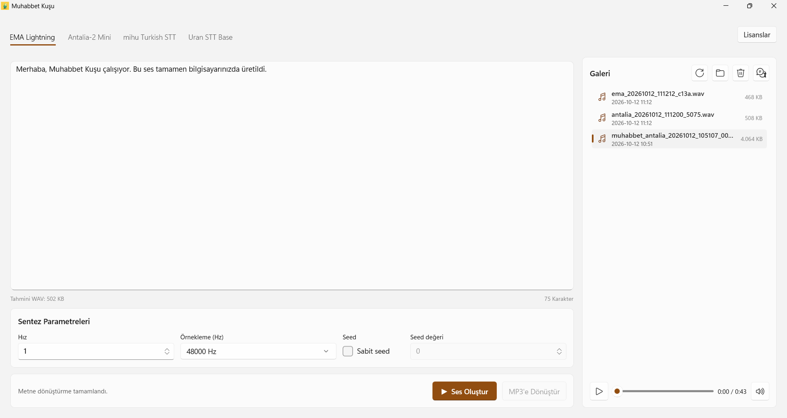
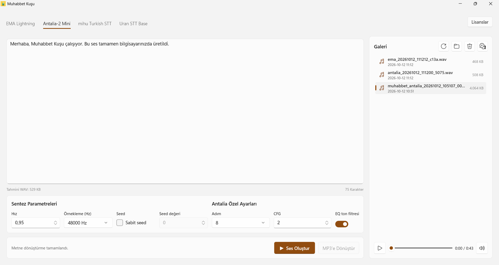
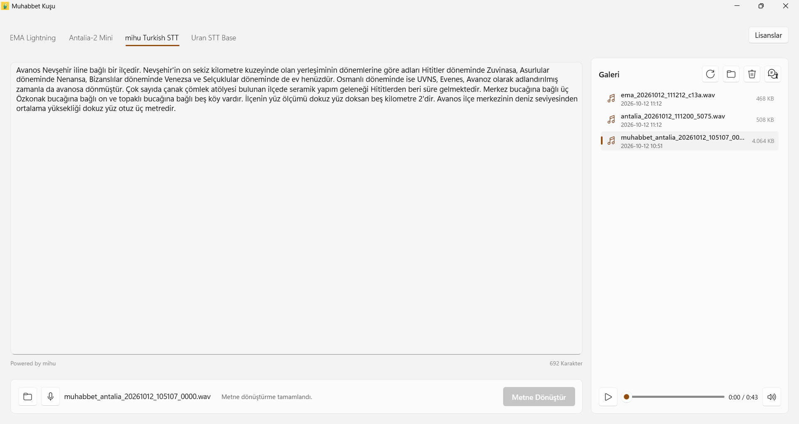
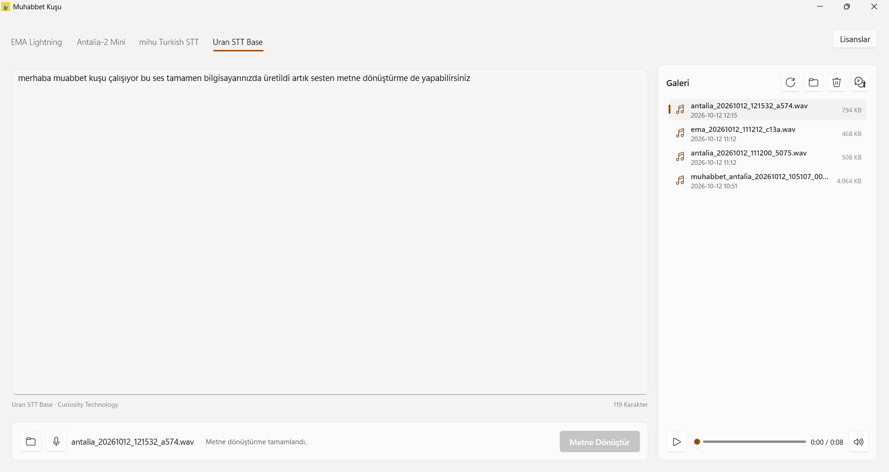

# Muhabbet Kuşu

Windows için yerel Türkçe ses uygulaması. Metinden sese ve sesten metne dönüştürme sağlar.

- Windows temasına uyumlu WinUI 3 arayüzü ve model sekmeleri.
- Mikrofon kaydı, ses dosyası seçimi ve yerel metne dönüştürme.
- Model parametreleri, ses galerisi, oynatma ve MP3 dönüşümü.
- Modeller indirildikten sonra çevrimdışı kullanım.

## Türkçe Ses Modelleri

Açık kaynaklı ve topluluk lisanslı Türkçe modeller:

- [EMA Lightning](https://huggingface.co/canberkkkkkk/ema-lightning) — Metinden sese.
- [Antalia-2 Mini](https://huggingface.co/cloud0day3/antalia-mini) — Metinden sese.
- [mihu Turkish STT](https://huggingface.co/mihuai/turkish-stt) — Sesten metne. Community License kullanım kısıtları içerir.
- [Uran STT Base](https://huggingface.co/curiositytech/uran-stt-base) — Sesten metne. Apache 2.0 lisanslıdır.

## Kurulum

[Son sürümü indir](https://github.com/brknl28/muhabbet-kusu/releases/latest). Windows 10 (2004 ve sonrası) veya Windows 11, x64 gerekir. Setup; .NET, Python, FFmpeg ve model çalışma bileşenlerini içerir.

TTS modelleri kurulum sırasında veya ilk açılışta indirilir. STT modelleri ilk kullanımda indirilir. Modeller uygulamanın `models/` klasöründe tutulur. Mikrofon ilk kullanımda izin ister. mihu modeli ayrıca kendi lisansının kabulünü ister.

Paket dijital imzalı değildir; Windows güvenlik uyarısı gösterebilir. Temiz Windows ortamı testi henüz tamamlanmadı.

## Ekran Görüntüleri

**EMA Lightning**



**Antalia-2 Mini**



**mihu Turkish STT — Powered by mihu**



**Uran STT Base**



## Geliştirme

.NET 8 SDK, Python 3.12 ve FFmpeg gerekir. İlk çalışma ortamını hazırlamak için Inno Setup 6.7+ kullanın:

```powershell
python -m pip install ema-lightning antalia-mini
python -m pip install --target artifacts/stt-runtime -r requirements-stt.txt
.\build-setup.ps1 -CompilerPath "C:\...\ISCC.exe"
.\build.ps1
.\run.ps1
```

Setup çıktısı `artifacts/setup/`, kurulum gerektirmeyen çıktı `publish/` klasöründedir. Taşınabilir ZIP için `scripts/package-portable.ps1` kullanın; model önbelleği ve ses kayıtları dışlanır.

## Lisans

Uygulama kaynak kodu [MIT](LICENSE) lisanslıdır. Üçüncü taraf bileşenler kendi lisanslarına tabidir. Uran modeli Apache 2.0; mihu modeli kısıtları bulunan Community License kapsamındadır. Powered by mihu.

[Lisans ve atıf bildirimleri](THIRD_PARTY_NOTICES.txt) · [Dağıtım kontrolü](docs/release-validation.md)
